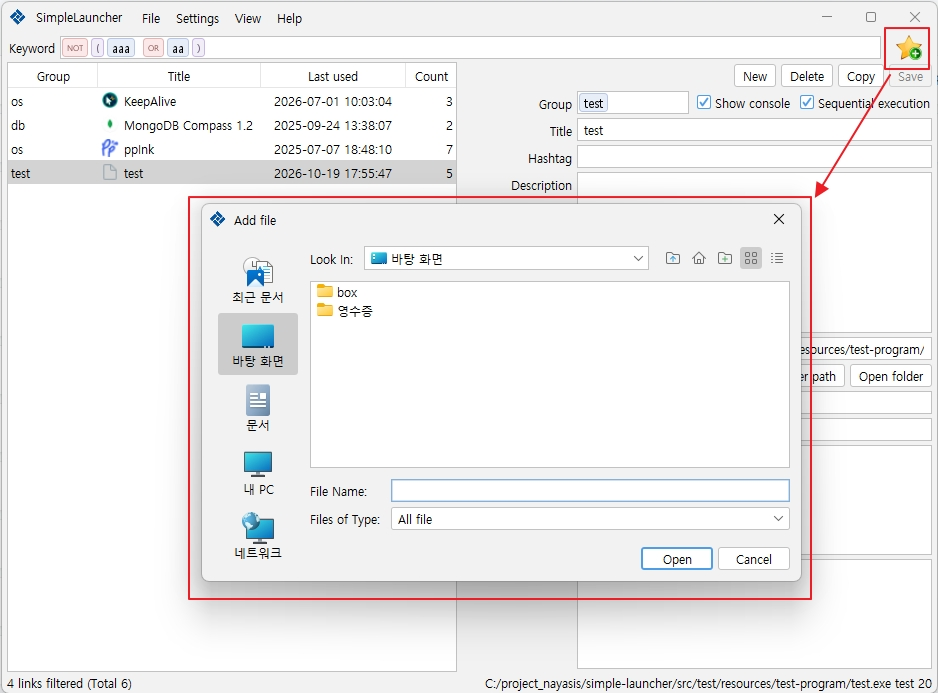
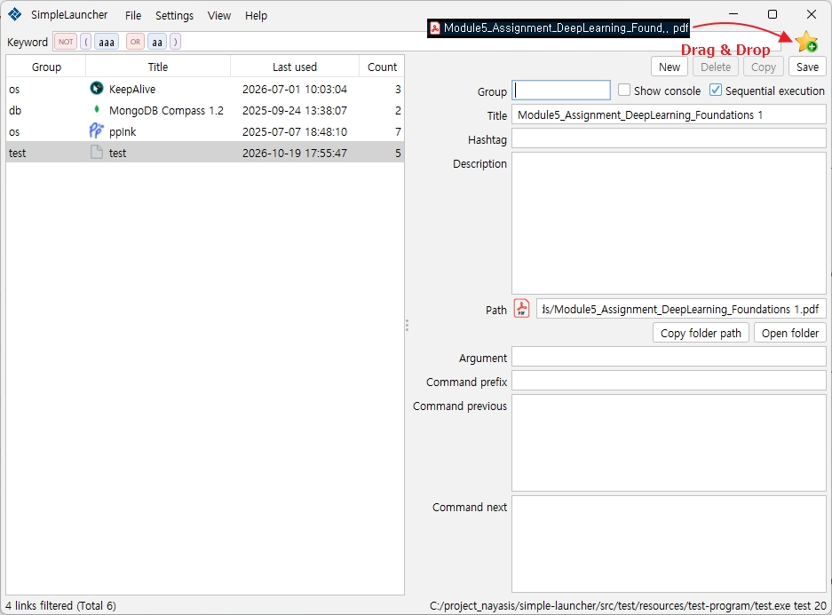

# Simple Launcher

## Introduction

**Simple Launcher** helps you launch applications quickly and find them easily.
You can configure each launcher item with a **relative path** or a **custom command**.


## Add link

Click the **star button** at the top right (or press `Ctrl + Shift + N`) and pick a file to add a new launcher item.



Or, you can drag and drop a file or directory onto the main window to add a new launcher item.



## Keyword search

The **Keyword** field searches the title and hashtags of each link (the group filter, `Alt + G`, searches groups the same way).
Matching ignores case. A term matches when the text contains it, or contains its letters in order (`kpa` finds `KeepAlive`).

A search is a row of chips: terms, operators and parentheses.


The search above, `NOT ( aaa OR aa )`, lists the links that contain neither `aaa` nor `aa`.

### Building chips

On macOS, use **Cmd** instead of **Ctrl**.

| Key                      | Action                                                                            |
|--------------------------|-----------------------------------------------------------------------------------|
| Enter                    | Turn the typed text into a term chip and search                                   |
| Ctrl + Enter             | Add the typed text as a term chip, even if it is `and`, `or` or `not`             |
| Shift + Enter            | Add the typed text as a term joined with OR (`and`, `or`, `not` become operators) |
| Ctrl + Shift + Enter     | Add the typed text as an operator or parenthesis chip                             |
| Left / Right             | Move the cursor between chips                                                     |
| Backspace / Delete       | Remove the chip next to the cursor (or the selected chip)                         |
| Ctrl + Z                 | Undo the last chip change (while the input is empty)                              |
| Right-click on the blank | Paste the clipboard                                                               |

### Operators

| Operator    | Typed as                  | Meaning                        |
|-------------|---------------------------|--------------------------------|
| NOT         | `not`, `-`, `!`           | Exclude the next term or group |
| AND         | `and`, `&`, `&&`          | Both sides must match          |
| OR          | `or`, `,`, `\|`           | Either side matches            |
| Parentheses | `(` `)`, `[` `]`, `{` `}` | Group terms                    |

- Chips without an operator between them are joined with AND.
- Precedence is NOT > AND > OR. Use parentheses to change it.
- Terms excluded by NOT (directly or inside a NOT group) match by substring only, without the in-order letter matching.
- If the expression is incomplete (for example, it ends with an operator), links that match any of its terms are listed.

## Shortcuts

All shortcuts can be changed in **Settings > Shortcuts**. The defaults are listed below.
On macOS, use **Cmd** instead of **Ctrl**.

### Menu

| Shortcut             | Description                   |
|----------------------|-------------------------------|
| Ctrl + Shift + **I** | Import application catalog    |
| Ctrl + Shift + **X** | Export application catalog    |
| Ctrl + **,**         | Open shortcut settings        |
| Alt + **E**          | Toggle detail launcher editor |
| Alt + **G**          | Toggle group filter           |
| Ctrl + Shift + **F** | Keep window always on top     |
| **F1**               | Show about                    |

### Main Catalog

| Shortcut             | Description                    |
|----------------------|--------------------------------|
| Enter                | Execute item                   |
| Delete               | Delete item                    |
| Ctrl + **C**         | Copy item folder path          |
| Ctrl + Shift + **O** | Open item folder               |
| Tab                  | Move focus to the link editor  |
| Esc                  | Move focus to the search field |

### Link Editor

Only works when the Link Editor is open.

| Shortcut                  | Description              |
|---------------------------|--------------------------|
| Ctrl + **N**              | New item                 |
| Ctrl + Shift + **N**      | Create link from file    |
| Ctrl + Shift + **Delete** | Delete item              |
| Ctrl + **D**              | Duplicate item           |
| Ctrl + **S**              | Save item                |
| Ctrl + Shift + **C**      | Copy item folder path    |
| Ctrl + **O**              | Open item folder         |
| Ctrl + **I**              | Change item icon         |


### Keyword History

When the keyword field is focused, enter history mode by pressing **Alt + Down**.


#### Keyword History Functions

| Shortcut        | Description                      |
|-----------------|----------------------------------|
| Alt + **Left**  | Move to the previous search word |
| Alt + **Right** | Move to the next search word     |
| Any key         | Filter executed links            |
| Esc             | Exit history mode                |

## Binding Parameters

An item's **option** (or prefix option) can include placeholders.
When you drag and drop a file (or directory) onto an item, these placeholders are replaced with path values.

| Parameter      | Description                      | Example                        |
|----------------|----------------------------------|--------------------------------|
| \${path}       | Full file path                   | C:\\Users\\user\\readme.md     |
| \${path-unix}  | Full file path (Unix style)      | C:/Users/user/readme.md        |
| \${dir}        | File directory path              | C:\\Users\\user                |
| \${dir-unix}   | File directory (Unix style)      | C:/Users/user                  |
| \${file}       | File name                        | readme.md                      |
| \${name}       | File name without extension      | readme                         |
| \${ext}        | Extension                        | md                             |
| \${home}       | User home directory              | C:\\Users\\***user***          |
| \${home-unix}  | User home directory (Unix style) | C:/Users/***user***            |

**Note:** `${path}` and `${path-unix}` (likewise `${dir}`, `${home}`) differ only on Windows.

### Example

```shell
ape2wav.exe "${path}" "${dir}\\${name}.wav"
```

## Data migration

In most cases, upgrading to a newer version works without manual migration.

If your catalog or settings are not preserved after an upgrade, use file export/import:

1. In the previous version, export the catalog (`Ctrl + Shift + X`).
2. Upgrade or install the new version.
3. In the new version, import the catalog (`Ctrl + Shift + I`).

This is the recommended fallback method when automatic upgrade does not work as expected.

## Requirements

- Java 25 or higher

## Build

#### 1. Clone source

```shell
git clone https://github.com/nayasis/SimpleLauncher.git
```

#### 2. Build

```shell
gradlew build
```

#### 3. Run

```shell
gradlew run
```

#### 4. Create native executable

Create a native executable (`.exe` on Windows) with jpackage.
Prepend `clean` (`gradlew clean makeExecutable`) for a clean build.

```shell
gradlew makeExecutable
```

The executable is generated in `build/dist/simplelauncher/`.
